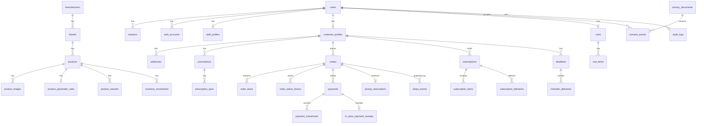

# Architettura

Next.js App Router. I componenti server sono la norma. Le azioni sensibili passano da Server Action o Route Handler e ricontrollano sessione, ruolo e proprietà del record.

## Autorità dei dati

- Pagamenti online e abbonamenti: Stripe è la fonte finanziaria. Neon conserva la proiezione aggiornata dai webhook firmati.
- Contanti e carta/POS in negozio: il registro interno (`payments`, `payment_movements`, `in_store_payment_receipts`) è la fonte. Non si creano PaymentIntent finti.
- Lo stock degli ordini online diminuisce solo nel webhook verificato. Il ritiro prenota lo stock all'atto dell'ordine interno.

## Ruoli

`ADMIN`, `OPERATOR`, `CUSTOMER`. Il proxy controlla solo la presenza del cookie di sessione. Ogni pagina e azione applica `requireStaffPage`, `requireStaffAction` o `requireOwnCustomer`.

## Flussi

1. Registrazione con prova HMAC dell'accettazione privacy, poi account Better Auth.
2. Carrello per occhio, checkout con ritiro o spedizione.
3. Pagamento online: Checkout Session. Pagamento al ritiro: ordine `PAYMENT_DUE_AT_PICKUP` senza Stripe.
4. L'operatore registra l'incasso in una transazione idempotente.
5. Il cron giornaliero ricalcola le scadenze e invia i promemoria di servizio.

## Schema relazionale

`stripe_events` non ha una foreign key verso gli ordini: l'identificativo evento è la chiave primaria e il payload non viene conservato. `app_settings` è una riga JSON `store`. `reminder_rules` descrive gli scostamenti. `verification_tokens`, `rate_limits`, `order_counters`, `privacy_requests`, `email_outbox`, `import_batches` e `request_rates` completano autenticazione, numerazione, privacy e limiti.
